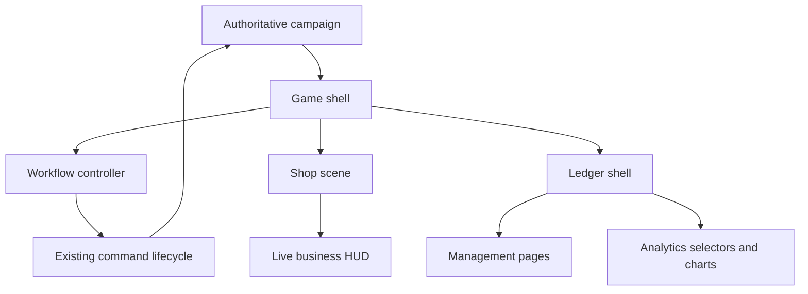
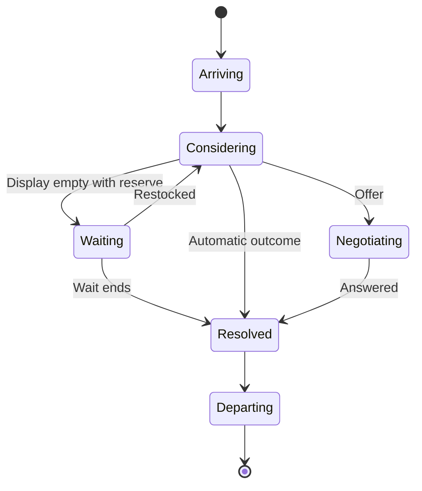
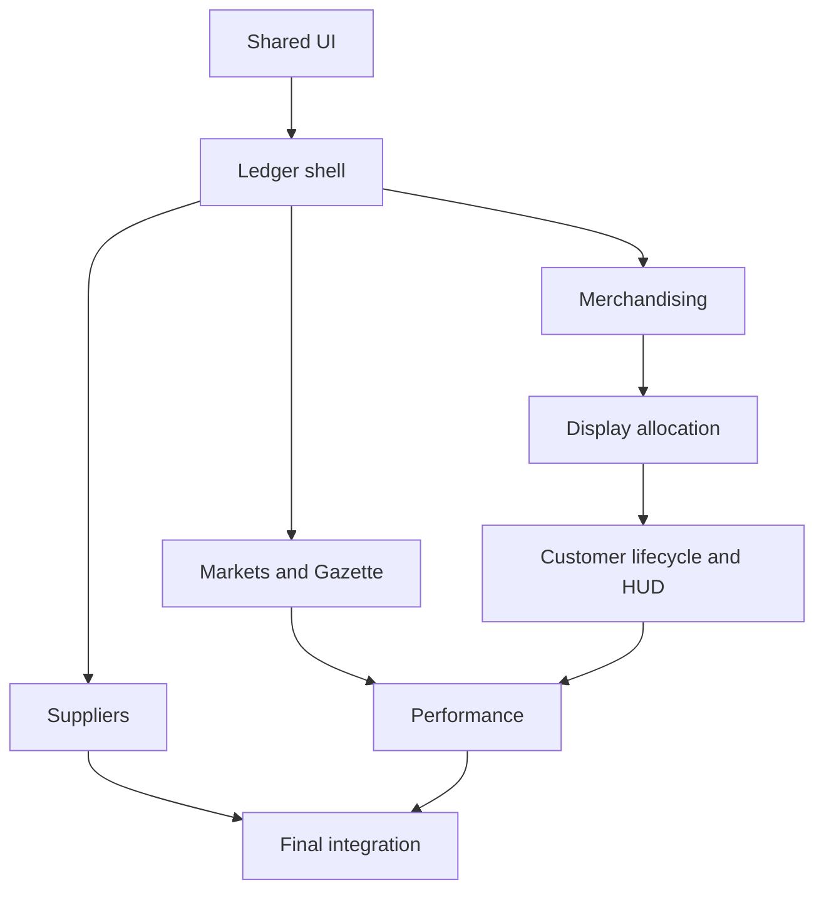

# Merchant Ledger — implementation roadmap

Status: implementation in progress for the approved [Merchant Ledger redesign](merchant-ledger.md). The design specification and its visual references remain authoritative for product decisions. This section records the current branch status; acceptance criteria below still describe the full target.

## Current implementation status

The `codex/merchant-ledger-redesign` branch has delivered phase-aware ledger workspaces, atomic display presets, town market comparison, a React Merchant Compass with town previews, saved Gazette editions, historical revenue/profit trends, and individual business visits. New shop sessions allocate limited display stock, persist a waiting customer, offer one refill decision for three seconds, and resolve that visit once. The server projection omits the unserved customer queue. The live HUD now shows visits, revenue, FIFO profit, gold, displayed/reserve stock, inventory value, and recent outcomes.

This branch is still short of the full redesign. Supplier comparison and merchandising are usable but remain inside the current ledger shell; the shared responsive component system, comprehensive React-ledger migration, more detailed market/performance chart interactions, final legacy control removal, and complete historical source/provenance detail remain outstanding. Historical FIFO cost and daily cash/stock values are recorded additively for new results; older records correctly show unavailable per-item cost details.

## Objectives and boundaries

Deliver a responsive, analytics-first fantasy trading interface with equal desktop and mobile functionality. Preserve the existing illustrated shop, its perspective and animated customer experience. Replace fragmented phase books with a unified ledger, reduce navigation friction, add interactive market and performance analytics, and implement the approved display-stock and daily pricing changes.

Keep the existing three towns, six commodities, two vendor visits per day, four displays, eight customer visits, manual negotiations, campaign independence, and FIFO cost accounting. Target approximately five minutes per day without limiting analysis time. World simulation, commerce-driven narrative, storage capacity, upgrades, customer dialogue systems, service minigames, negotiation automation and tutorials remain deferred.

## Current architecture and migration risks

| Existing component | Relevant behavior | Migration direction |
| --- | --- | --- |
| `apps/web/src/App.tsx` | Campaign loading, revision-checked command submission, pending receipt retries | Preserve command lifecycle and ownership boundaries |
| `apps/web/src/Game.tsx` | Canvas mount, separate ledger dialog, announced customer presentation | Become unified game shell and presentation coordinator |
| `apps/web/src/CanvasShop.ts` | Scene, book pages, local navigation, purchase/pricing controls and visit playback | Extract scene and animation responsibilities; move management controls to React |
| `apps/web/src/Ledger.tsx` | Independently navigated inventory/history/market/event/newspaper pages | Reuse useful selectors and replace modal with shared ledger |
| `apps/web/src/ShopLayout.ts` | Fixed relative scene and book bounds | Preserve scene registration; retire fixed book geometry |
| `apps/web/src/ShopArt.ts`, `ShopAssets.ts` | Current shop artwork, dial, characters, props | Reuse actual artwork; relocate dial into Markets |
| `packages/contracts/src/index.ts` | Commands validated with Zod | Add compatible configuration and restock commands |
| `packages/game-core/src/index.ts` | Inventory, shelves, daily transitions, batch customer resolution, journal | Own pricing, display allocation, per-visitor resolution and accurate history |
| `packages/game-core/src/catalog.ts`, `market.ts`, `world-news.ts` | Deterministic prices, customer budget range, offers, reports | Provide typed market information with provenance |
| `apps/api/src/app.ts` | Campaign row lock, ownership, revision check and atomic receipt | Preserve this transaction boundary; expose appropriate campaign views |

**Critical dependency:** `advanceBusiness()` currently resolves multiple customers per server command until a negotiation or closing, while the browser plays back those outcomes later. Restocking between visits cannot work correctly with pre-resolved sales. Introduce per-visitor resolution before enabling limited displays in live business. Changes to new business rules and their UI must be activated together, even if developed in separate reviewable changes.

## Target architecture



Suggested frontend module boundaries (names may change to fit repository conventions):

```text
apps/web/src/
  game/          GameShell, GameWorkflow, BusinessController
  scene/         ShopScene, ShopArt, ShopAssets, ShopLayout
  ledger/        LedgerShell, LedgerNavigation, pages/
  analytics/     marketSelectors, performanceSelectors, inventorySelectors
  charts/        shared interactive chart components
  components/    reusable controls, tables, metrics, panels
  styles/        theme tokens and responsive layout
```

Use React for management navigation, layouts, structured tables, inputs and accessible controls. Retain PixiJS/WebGL for the shop, customer animation, item/gold effects, shelf highlights and compass artwork/animation. Shared chart components may use SVG, Canvas or GPU rendering as appropriate. Evaluation of a chart library (e.g. ECharts) versus small custom components should prioritize responsive touch inspection, accessibility, visual customization, useful interactions, bundle size and maintenance. Pin any selected dependency in the committed pnpm lockfile.

Keep authoritative campaign state separate from presentation state. The client may preserve drafts, selected pages, filters, selected town previews, chart ranges and animation progress, but only confirmed commands change gameplay. Centralize the mapping from accepted campaign changes to default workspaces. Use the existing request ID, expected revision, pending action retry and stale-state reconciliation logic.

## 1. Shared UI framework

Build reusable components and theme tokens before migrating individual screens.

| Component | Responsibility |
| --- | --- |
| `GameHeader` | Day, location, stage, gold, relevant status |
| `LedgerNavigation` | Responsive navigation and active page |
| `LedgerPanel`, `MetricCard` | Shared analytical surfaces and KPI hierarchy |
| `DataTable` | Semantic, sortable, responsive tables |
| `CommodityIcon`, `TownEmblem` | Existing asset reuse |
| `QuantityStepper`, `PricePreset`, `BudgetRange` | Purchasing and pricing inputs |
| `StatusBadge`, `ActionBar` | State, invalid conditions and current workflow action |
| `ChartPanel` | Axis, legend, inspection and consistent empty states |

Use gritty dark leather/wood framing, aged brass, desaturated parchment, dark green primary actions, rust/burgundy negative values, restrained decoration, legible serif headings and tabular numerical text. Build responsive grids and stacked layouts, consistent focus, touch targets, loading/error/pending/offline states and reduced motion. Use approved boards as visual guidance, not as exact data or game rules.

**Acceptance:** shared components support desktop and portrait mobile without fixed canvas coordinates; existing gameplay remains launchable.

## 2. Ledger shell and workflow

Consolidate persistent Ledger and phase books into one non-modal management workspace. Provide Overview, Markets, Suppliers, Inventory, Merchandising, Performance and Gazette pages. Full-screen management is normal; docked/compact states are useful only when compatible with the current stage.

| Authoritative state | Default workspace |
| --- | --- |
| `travel` | Markets with integrated news |
| `prepare`, buying incomplete | Suppliers, restored active visit if any |
| `prepare`, buying complete | Merchandising |
| `open` | Existing shop and live HUD; contextual negotiation or restock prompt |
| `report`, final animation complete | Performance |

Automatically transition after successful commands, not merely clicks. Allow unrestricted browsing outside business, retain draft/filter state across navigation, and keep the current stage action visible. During business restrict the ledger to live statistics and required decisions. On refresh restore the authoritative phase, pending visit/decision, and appropriate presentation. Preserve errors, retries and offline behavior without adding offline writes. Migrate individual pages incrementally; keep legacy controls only until their replacement is functional.

**Acceptance:** the entire existing shop loop remains accessible while migrated stages open their own workspace automatically, without manual book opening.

## 3. Market information foundation

Introduce typed information categories: actual transaction, exact shop observation, observed vendor quote, market report, current estimate and forecast. Include good, town, day, value or range, source/category and optional confidence metadata. Use a common data provider so future economic simulation can supply different values without changing the UI.

- Generate permitted estimates from the existing deterministic market and `priceRange()` initially; do not implement a new economy.
- Record reports and observations when issued. Never recreate historical observations by applying modified future rules to old days. Missing history is not zero.
- Provide estimated local retail across towns before travel, with relevant aggregate reports and imperfect forecasts. Do not reveal individual seller offers, stock or specific current deals before arrival.
- On arrival expose the local vendors' actual current offers and quantities. Distinguish regular, reputation-discounted and deal prices from prices actually paid.
- Keep exact past shop results and actual purchases clearly distinct from imperfect market reports or forecast values.
- Do not disclose future customer budgets or outcomes through charts or player presentation. Review the campaign response projection and distinguish public presentation data from internal generation state; preserve server-authoritative transitions.

Record necessary new historical fields additively from the first release that produces them, rather than waiting until dashboard work is complete.

**Acceptance:** market and ledger consumers read consistent typed information without fabricated historical observations or prematurely disclosed offers.

## 4. Markets and Gazette

Build the Market Explorer as the default morning and destination workspace.

- Default commodity-by-town comparison matrix using Grain, Herbs, Cloth, Tea, Iron and Crystal across Meadow, Forge and Harbor. Support commodity-first and location-first modes; synchronized selection drives the detailed chart, relevant news and town preview.
- Show estimated retail prices, demand/budget context, held inventory and meaningful trend indicators. Highlight favorable conditions without choosing a route for the player.
- Interactive chart: select commodity, town series, relevant aggregate benchmark, observed historical purchase points, report history, forecast segments, date range, series toggles, hover/tap exact-value inspection and zoom. Distinguish forecasts with dashed styling and textual labels.
- Move the existing dial artwork to an interactive Merchant Compass in the ledger. Select a town via compass, emblem or comparison cell. Preview the town vista when the scene is visible. Explicit **Travel to [Town]** sends `chooseTown`.
- Integrate current morning headlines with links to full articles in Gazette, including historical editions. No mandatory separate newspaper page.
- Desktop: persistent left navigation, compass and matrix, large chart, headlines and action bar. Mobile: compact navigation, full-width compass, responsive matrix, touch chart, expandable headlines and sticky travel action.

**Acceptance:** a player can compare all towns, inspect available history and choose a destination without separate book transitions or revealing current individual vendor offers.

## 5. Supplier workspace

Reuse existing `visitVendor`, `leaveVendor`, `buy`, and `finishBuying` commands. Consolidate all local suppliers into one comparison workspace with expandable offers.

- Show vendor identity/archetype, effective prices, stock, regular and special offers, reputation requirements, current tier/progress, visited/active state and visits remaining.
- Inspect every vendor before consuming either daily visit. Explicit Begin Visit spends one of the two visits even without a purchase. No revisits; preserve existing visit restrictions.
- Inline quantity steppers, unit price, total and expected remaining gold. Clearly disable unaffordable, locked and sold-out offers with reasons. Do not optimistically record a purchase.
- After accepted purchases update inventory, gold, remaining stock and reputation/price benefits in place. Preserve active vendor and comparison context.
- Allow ending an active visit and moving to another. If combined into a command, validate and commit the whole operation atomically; otherwise use existing confirmed leave/visit actions. Finish/skip buying opens Merchandising automatically.

**Acceptance:** compare suppliers, use up to two visits, buy multiple lots and prepare the shop without navigating separate purchase books.

## 6. Merchandising and price presets

Build an editor for the four displays together, with a four-column or two-by-two desktop grid and stacked mobile cards. Show good selection, total stock, capacity, next-unit FIFO cost, local estimated retail, budget range, selected preset/price and indicative margin. Allow empty slots and one display per commodity. Synchronize scene display assignments; scene selection/highlights are optional complementary controls.

Only the values 80%, 100% and 120% are valid. Define a shared game-core rule: baseline is the midpoint of the day's estimated local retail budget range; proposed rounding is nearest integer gold, clamped to valid price bounds. The server computes the resulting price, and the browser previews the same result using the shared rule. Record chosen preset and absolute price. A budget-range bar shows the selected price relative to the estimated range, including markers outside the range. Do not invent buyer probability distributions.

Preserve yesterday's stocked product assignments where feasible. Reset pricing to 100% each day, recalculating once the next town is chosen. Clear assignments with no remaining stock, permit reconfiguration in preparation, and freeze assignments and prices when business starts.

Proposed additive atomic command:

```ts
type PricePreset = 80 | 100 | 120;
type ConfigureDisplays = {
  type: 'configureDisplays';
  displays: Array<{ slot: number; goodId: GoodId | null; pricePreset: PricePreset }>;
};
```

Validate all four unique slots and assignments together so swapping products cannot fail halfway through. Retain the old absolute `price` field and legacy `shelf` command for compatibility, with explicit handling of old in-progress configurations. Persist configuration before opening or combine configuration/opening atomically if appropriate; do not open on a partially failed edit.

**Acceptance:** prepare all displays, choose only approved presets, see the resulting prices and open the shop without nested numeric entry or shelf dialogs.

## 7. Display allocation and restock rules

Keep inventory lots as canonical owned stock and FIFO valuation. Add optional per-slot displayed quantities to the snapshot; use a configurable fixed capacity in game-core (proposed initial capacity: three). Reserve units are total owned less displayed units; the same stock is not valued twice.

Opening a new business session allocates as many units as available up to each assigned display's capacity. Sales decrement displayed units and canonical inventory by one, applying FIFO cost once. Restocking only moves reserve allocation to the selected display, without changing total owned stock, acquisition lots or gold.

```ts
type DisplayStock = { slot: number; quantity: number };
type RestockDisplay = { type: 'restockDisplay'; slot: number };
```

Validate business phase, slot, assigned good, remaining owned quantity, display capacity and outstanding decision. Fill the display to capacity or available reserve, in one authoritative command. Record actual replenished quantity. Preserve invariants: displayed quantity is nonnegative, does not exceed capacity or owned inventory, and cannot duplicate stock. One-click/tap; no automatic replenishment or quantity selector.

Implement this behind the compatible business-mode boundary until Phase 8 is ready. The old batch resolver must never consume units from a new limited-stock business without allowing the approved individual visit interactions.

**Acceptance:** when enabled alongside the new customer lifecycle, selling and replenishment preserve total stock/FIFO accounting and retries cannot duplicate inventory.

## 8. Customer lifecycle

Refactor `advanceBusiness()` and negotiation continuation for new-mode days to advance only one customer through their lifecycle. Keep seeded customer order and existing negotiation rules; no new personality or service mechanics.



Persist the current visit identity and any unresolved replenishment/negotiation decision. Implement a server-authoritative transition for beginning or resolving a visit, with the current customer index checked against campaign state; timers in the browser only request transitions. Define a deterministic policy for restock-vs-resolution races using existing revision checks and persisted decision state. After replenishment, determine ordinary sale or negotiation normally. When the brief window expires, resolve the missed sale once. When no reserve exists or the commodity is unassigned, preserve existing missed-sale behavior.

Keep roughly five seconds for normal animated visits, with proposed three additional seconds for a restocking opportunity. Arrival, consideration, result and exit should remain distinct. Pause for negotiations. A reload must restore the current committed decision without skipping or repeating a customer, and offline/pending actions must not silently resolve independently. Do not expose results before presentation. Open the closing dashboard only after the eighth outcome and departure are presented.

**Compatibility:** retain the existing `travel`, `prepare`, `open`, `report` phase values and `rulesVersion` 1. Introduce optional per-day business-mode state as needed. Existing in-progress open days should finish safely with legacy semantics unless migrated without changing accepted decisions. Ensure previous release can read new snapshot shapes and rollback behavior is well-defined; preserve legacy fields and use additive optional records. Do not activate incompatible commands on an older server. Document activation and rollback before release.

**Acceptance:** a waiting customer can receive replenished stock and resolve exactly once; each new-mode visit is processed individually, including ordinary sales, negotiation and the final visit.

## 9. Live business presentation

Retain the actual current shop art, framing, perspective, windows, shelves, doorway, counter and characters. Remove the door-mounted dial. Do not implement a replacement room based on the mockups.

- Desktop: prominent shop with compact header and bottom/side live performance area.
- Mobile: portrait-friendly scene, equally usable shelf controls and compact metrics/feed; keep key shop interactions visible.
- Show presented progress out of eight, revenue, FIFO gross profit, presented gold, latest request/outcome, display quantities, reserves and a concise transaction feed.
- Provide low/empty display indicators, contextual one-click refill prompts and accessible keyboard/touch equivalents. Indicate a waiting customer's requested good clearly.
- Present existing negotiation choices automatically in a contextual panel; return focus to business on resolution.
- Preserve arrival/departure and item/gold effects. Scene effects and chart transitions must not mutate game state. Present stock, cash and profit together when the corresponding result is revealed; no future-outcome leakage.
- Hide full historical ledger navigation during business; only current-day performance is visible.

**Acceptance:** normally animated customer service is the central experience, with restocking and negotiation available directly and no requirement to navigate management books.

## 10. Historical records and analytics foundation

Extend the existing optional journal and daily summaries additively as the relevant features ship. Keep actual historical observations immutable. Preserve the existing field meanings and distinguish unavailable, zero and not-yet-recorded values.

| Record | Additive details |
| --- | --- |
| Market report/observation | Date, source/category, town, commodity, aggregate estimate, observed quote/offer type |
| Purchase | Offer category, paid unit cost, quantity, vendor and relevant reputation |
| Display configuration/opening | Preset, actual price, initial display allocation |
| Restocking | Slot, good, actual replenished quantity |
| Customer outcome | Listed and realized price, actual FIFO unit cost, reason, customer index |
| Day closing | Starting/ending gold, remaining stock value, summary totals |
| Newspaper | Issued edition, published articles and outlook |

Record FIFO cost when the unit is sold; do not infer it later from current inventory. Preserve actual buying quotes when reputation changes. Record daily history only once. Use derived selectors for chart series, grouped metrics, inventory and filters; avoid duplicating aggregates in presentation state. Initially use the snapshot/journal rather than a new analytics database; add pagination or aggregation later when scale requires it.

**Acceptance:** exact results are reproducible from recorded facts; older campaigns show available detail without inventing missing values.

## 11. Closing and performance dashboards

Create the default daily dashboard and historical Performance workspace. Use a concise overview with optional drill-downs; all charts and tables have touch-accessible inspection and relevant filter/reset controls.

- KPI cards: gross profit, revenue, COGS, gross margin, ending gold, starting gold, wholesale spending, conversion and remaining inventory at cost.
- Cash waterfall: starting gold minus wholesale purchases plus sales revenue equals ending gold. Do not treat COGS as an additional cash outflow.
- Profit: revenue minus FIFO COGS. Gross margin is profit divided by revenue where nonzero. Conversion is completed sales divided by resolved customers.
- Interactive historical revenue/profit, gold/stock value, profit by commodity, sales/performance by town, conversion, missed-sale reasons, pricing outcomes, vendor spend and reputation, and underlying transaction details.
- Date, town, commodity, vendor, preset and customer-outcome filters where supported. Selecting a datum filters related charts or links to the appropriate market/inventory view. Show filters and empty states explicitly.
- Closing review links unsold stock and missed-sale outcomes to relevant next-day market information as decision aids, without a guaranteed recommendation.
- Desktop multi-column dashboard; mobile stacked charts or expandable detail panels, with equivalent analysis. Explicit **Begin next day** returns to integrated Markets briefing.

**Acceptance:** the merchant understands what happened today, can explore accurate historical evidence and can use insights to plan tomorrow.

## Merge request sequence and dependencies

| MR | Scope | Dependencies / release note |
| --- | --- | --- |
| 1 | Theme, reusable UI, responsive primitives and reference integration | None |
| 2 | Ledger shell and central automatic workflow | 1; retain functional fallbacks |
| 3 | Market data, Explorer, compass and Gazette | 2 |
| 4 | Supplier workspace | 2 |
| 5 | Merchandising, presets and atomic configuration | 2; retain compatible command shape |
| 6 | Display allocation and restock commands | 5; inactive until MR 7 |
| 7 | Individual customer lifecycle and live HUD | 6; activate business feature as a compatible unit |
| 8 | Performance dashboards and remaining history extensions | 3, 7; capture supporting facts in earlier MRs |
| 9 | Legacy UI removal, responsive integration and polish | All relevant replacements complete |



Keep each MR launchable and reviewable. Do not publish incomplete command/feature combinations. Update `docs/plan.md`, `docs/architecture.md` and affected phase specifications alongside implementation so they accurately describe shipped behavior. Remove legacy book state, fixed book geometry and duplicate UI only when replacements are ready; retain compatible domain paths as required for saves and rollback.

## Verification and release constraints

- Use Node 24 and pnpm with the committed lockfile; check type correctness and production build.
- Keep automated tests limited to the existing supported-browser/device startup/render smoke check (`pnpm test:browser:smoke`) unless the user explicitly asks for additional tests. Do not add geometry, screenshot/pixel, gameplay/auth interaction, source, domain or API assertions.
- Manual design review desktop and mobile for each major workspace; manually walkthrough ordinary days and relevant edge cases, including reloads, invalid quantities, sold-out displays, negotiation, final-visit closing, old history and pending/retried actions.
- Keep launch setup minimal. CI builds and starts release containers, checks live/ready/version endpoints and runs the minimal platform smoke check. Preserve production signed image provenance and deployed health checks.
- Maintain campaign ownership, atomic transactions, idempotent receipts, stale-revision protection, independent campaigns, forward-compatible saves and previous-release-compatible migrations. No production resets.

## Proposed tuning defaults (not finalized)

| Parameter | Initial proposal |
| --- | --- |
| Display capacity | 3 units per display |
| Extra restock wait | 3 seconds |
| Price rounding | Nearest integer gold with valid bounds |
| Default chart range | Last 14 days |
| Normal customer pacing | Approximately 5 seconds per visit |
| Desktop navigation | Persistent left rail |
| Mobile navigation | Compact expandable navigation |
| Historical report confidence | Source-based labels initially |

Begin with MRs 1 and 2. Prioritize the unified visual and navigation foundation, then build management workspaces and tackle the more substantial customer-state changes behind a compatibility boundary.
